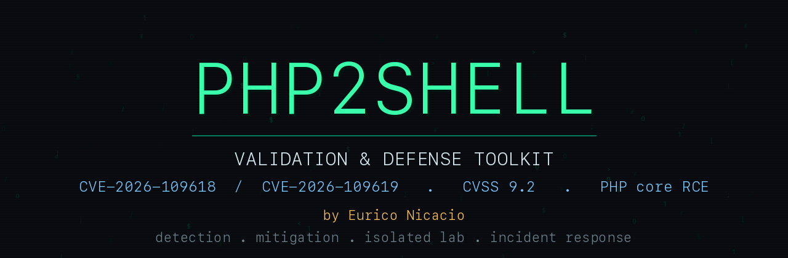

<p align="center">
  
</p>

# PHP2Shell Validation & Defense Toolkit

**CVE-2026-109618 / CVE-2026-109619 — unauthenticated RCE in PHP core (CVSS 9.2)**

By **Eurico Nicacio**.

Tooling to let operators **check whether their PHP is exposed to PHP2Shell**,
apply interim mitigations across the whole stack, and detect exploitation —
without shipping a weaponized remote-code-execution exploit.

> **Scope.** For defenders and for authorized assessment of systems you own or
> have written permission to test. It contains no public RCE exploit by design.
> The complete fix is upgrading PHP. See [`SECURITY.md`](SECURITY.md).

## The vulnerabilities

Two critical, pre-authentication memory-safety flaws in **PHP core** (not in
WordPress/Drupal/Joomla — those were only demonstration targets), disclosed
21 October 2026, with early in-the-wild attacks the same day.

| CVE | Class | Impact |
| --- | --- | --- |
| CVE-2026-109618 | Upload-progress unserializer use-after-free | Unauthenticated RCE, worker-memory disclosure |
| CVE-2026-109619 | Fatal-error backtrace UAF + OPcache type confusion | Unauthenticated RCE |

Full mechanism in [`docs/TECHNICAL.md`](docs/TECHNICAL.md). Root-cause details
are still settling across advisories; defer to the official PHP advisory.

### Affected and fixed ([`docs/affected-versions.md`](docs/affected-versions.md))

| Branch | First fixed release |
| --- | --- |
| 8.5.x | 8.5.12 |
| 8.4.x | 8.4.27 |
| 8.3.x | 8.3.36 |
| 8.2.x | 8.2.35 |
| ≤ 8.1 | End-of-life — no official fix, upgrade the branch |

## What's here

```
exposure/      Checkers + scanners (see exposure/README.md):
   check_php2shell.py/.sh     passive version/config audit + header-only remote
   scan_fleet.py              header-only version sweep across many hosts
   php2shell_scan.py          active, non-destructive validator (authorized only)
mitigations/   Interim hardening across the stack:
   php.ini.hardening.ini      disable upload-progress + error/memory notes
   quick-fix/run.sh           check / dry-run / apply / revert the config mitigation
   nginx-block.conf           multipart / body / read-only options
   apache/                    ModSecurity rule + .htaccess
   lighttpd/                  multipart deny
   frankenphp/                Caddyfile snippet
   cloudflare/                edge WAF rules (multipart + body inspection)
   patch/                     source-patching + EOL guidance (points to upstream)
hunting/     Host, log, IDS signals + PHP-worker process watcher
lab/           Isolated Docker target to validate the hunting/mitigation pieces
docs/          Technical summary, affected versions, FAQ
```

## Quick start

```bash
# Check the local PHP install (version + config audit)
python3 exposure/check_php2shell.py
#   or
bash exposure/check_php2shell.sh

# Judge a specific version string
python3 exposure/check_php2shell.py --version 8.3.12

# Header-only fingerprint of a host you are authorized to assess
python3 exposure/check_php2shell.py --url https://example-you-own.test

# Sweep many hosts (one per line; header-only, no payloads)
python3 exposure/scan_fleet.py hosts.txt
```

The checkers never send exploit payloads. The remote mode only reads the PHP
version a host advertises in headers; a hidden version returns `UNKNOWN`, which
is not a clean bill of health.

## Apply the mitigation fast

```bash
sudo mitigations/quick-fix/run.sh --check     # report current state
sudo mitigations/quick-fix/run.sh --dry-run   # preview changes
sudo mitigations/quick-fix/run.sh             # apply (disable upload-progress)
sudo mitigations/quick-fix/run.sh --revert    # undo
```

Then add the WAF/edge rule for your front end from `mitigations/` and reload.

## If you are exposed

1. **Patch PHP** to the fixed release for your branch — the only complete fix.
2. Until you can patch, apply `mitigations/` (disable `session.upload_progress`
   in `php.ini`/the FPM pool, add the WAF/edge rules). Consider a read-only or
   maintenance posture for exposed high-risk hosts.
3. Enable the `hunting/` signals and review logs for the disclosure-day window
   and for PHP workers spawning shells/interpreters.

## Validate the toolkit in a lab

See [`lab/`](lab/): an isolated, internet-blocked Docker target running an
unpatched PHP so you can confirm the checker reports `VULNERABLE`, your WAF rules
block the trigger, and your log/IDS signals fire — then flip the image to a
patched tag and watch it go `PATCHED`.

## Responsible use

Use only against systems you own or are explicitly authorized to test. Do not
point the remote/fleet checker at third-party hosts. See [`SECURITY.md`](SECURITY.md).

## References

- Cloudflare — PHP vulnerabilities / WAF protection advisory (2026-10-21)
- Wiz Research — php2shell.com advisory
- Sansec — PHP2Shell critical PHP RCE research
- Malwarebytes Labs — PHP2Shell emergency-update coverage
- Official PHP release announcements for 8.2.35 / 8.3.36 / 8.4.27 / 8.5.12

## License

MIT © 2026 Eurico Nicacio. See [`LICENSE`](LICENSE).
